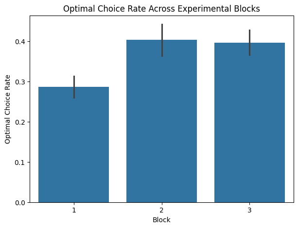
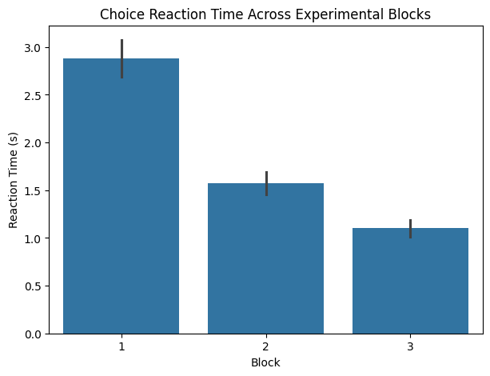
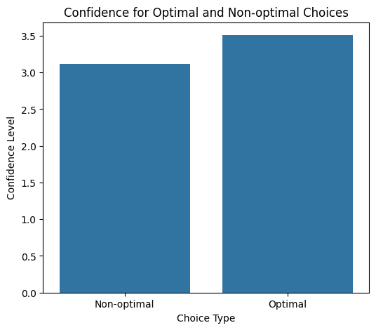
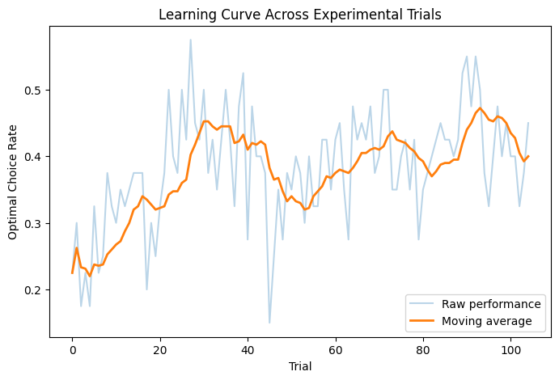
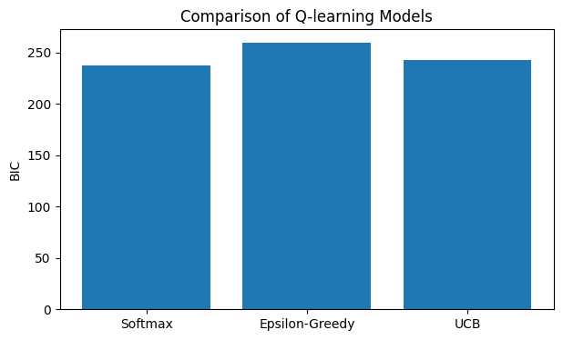

# Behavioral Decision-Making and Computational Modeling

A computational cognitive science project studying decision-making in a four-option probabilistic learning task. The repository combines a PsychoPy experiment, a behavioral-analysis notebook, statistical results, and individual-level Q-learning model implementations.

## Project overview

Participants repeatedly choose one of four cards, report their confidence, and receive probabilistic reward feedback. The four card identities have reward probabilities of 0.70, 0.60, 0.50, and 0.40.

The project includes:
- A PsychoPy implementation that generates participant-level CSV files.
- A Jupyter Notebook for behavioral and metacognitive analysis.
- Implementations of Softmax, Epsilon-Greedy, and probabilistic UCB Q-learning models.
- Saved aggregate results, tables, and figures from the original analysis run.
- Technical documentation describing the experiment, data schema, statistical workflow, and modeling assumptions.

## Repository structure

```text
computational-cognitive-science-decision-making/
├── experiment/
│   ├── run_experiment.py
│   └── assets/
├── analysis/
│   └── behavioral_analysis.ipynb
├── data/
│   └── README.md
├── results/
│   ├── figures/
│   ├── tables/
│   └── README.md
├── docs/
├── tests/
├── README.md
├── requirements.txt
└── .gitignore
```

## Experimental design

The included experiment generates 105 trials per participant:

| Block | Number of trials |
|---|---:|
| Block 1 | 15 |
| Block 2 | 30 |
| Block 3 | 60 |
| **Total** | **105** |

At the beginning of each block, the four card positions are randomized. Their positions remain fixed during that block. Participants select cards using `A`, `D`, `G`, and `J`, then report confidence using keys `1` through `5`.

## Data availability and generation

**No participant-level datasets are included in this repository.**

The experiment code generates new participant records in the format expected by the analysis notebook. Run:

```bash
python experiment/run_experiment.py
```

Enter an anonymous numeric participant code and select the participant group. The generated CSV is saved under:

```text
data/
├── Male/
│   └── participant_001.csv
└── Female/
    └── participant_002.csv
```

Each CSV contains the following analysis fields:

| Column | Description |
|---|---|
| `trial` | Zero-based global trial index (0–104) |
| `choice` | Selected screen-position index (0–3) |
| `outcome` | `win` or `lose` |
| `choice_rt` | Choice reaction time in seconds |
| `confidence_level` | Confidence rating from 1 to 5 |
| `confidence_rt` | Confidence-response time in seconds |
| `card probs` | Reward probabilities in current screen-position order |

The notebook derives `participant_id` from the filename, `gender` from the parent folder, and block membership from the trial index. Generated participant data are excluded from version control through `.gitignore`.

See [Data Availability and Generation](data/README.md) for the complete schema.

## Saved analysis results

The figures, aggregate tables, and saved Notebook outputs are retained from the original analysis run. They are included as results; the participant-level source dataset is not included.

New participants collected using the experiment code will produce new results. The numerical values below are the saved results from the original analysis and are not expected to be reproduced exactly by a new sample.

### Behavioral performance across blocks

| Block | Mean reward rate | Mean optimal-choice rate |
|---|---:|---:|
| 1 | 0.5483 | 0.2867 |
| 2 | 0.6083 | 0.4033 |
| 3 | 0.5971 | 0.3971 |

The block effect was not statistically significant for reward rate (Friedman p = 0.241), while optimal-choice rate differed across blocks (Friedman p = 0.035).

### Optimal-choice rate



### Reaction time

Mean choice reaction time decreased from 2.880 seconds in Block 1 to 1.101 seconds in Block 3. The Friedman test was statistically significant (p < 0.001).



### Confidence

Mean confidence was higher for optimal choices (3.508) than non-optimal choices (3.115). The participant-level Wilcoxon signed-rank test was statistically significant (p = 0.000368).



### Learning trajectory

The mean optimal-choice rate increased from 0.2867 in the early trials to 0.4300 in the late trials (Wilcoxon p = 0.003584).



## Computational modeling

Three Q-learning variants were compared using participant-level negative log-likelihood, AIC, and BIC.

| Model | Mean NLL | AIC | BIC |
|---|---:|---:|---:|
| **Softmax** | **114.1723** | **232.3446** | **237.6525** |
| Epsilon-Greedy | 125.1315 | 254.2630 | 259.5709 |
| UCB | 116.6158 | 237.2316 | 242.5395 |

Softmax achieved the lowest information-criterion values among the three implementations in the original analysis.



## Important interpretation notes

- The saved numerical results are based on the original analysis dataset, which is not distributed here. New data generated by the experiment code will produce new estimates.
- The Q-learning likelihood functions use screen position as a stable action index, although card positions are remapped between blocks. Q-values are also carried across block boundaries. This is a simplifying assumption and limits the cognitive interpretation of the fitted parameters.
- The UCB model applies a Softmax transformation to UCB scores using a fixed inverse temperature of 5.
- The Epsilon-Greedy learning-rate parameter remained at its initial value of 0.5 in the original fit.
- Trial-level reaction-time comparisons do not account for the nesting of trials within participants.
- The confidence-difference score is an operational descriptive measure, not a formal metacognitive-efficiency estimate such as meta-d′.

Further details are available in the [Results and Interpretation](docs/results_and_interpretation.md) and [Computational Modeling](docs/computational_modeling.md) documents.

## Getting started

### Install dependencies

```bash
python -m pip install -r requirements.txt
```

PsychoPy is required to run the experiment. Jupyter and the scientific Python packages are required for analysis.

### Generate participant data

```bash
python experiment/run_experiment.py
```

Complete the experiment for each participant. The script creates the required data folders and saves one CSV file per participant.

### Run the analysis

After collecting participant files, launch Jupyter from the repository root:

```bash
jupyter lab
```

Open `analysis/behavioral_analysis.ipynb` and run the cells in order.

## Documentation

- [Experimental Design](docs/experiment_design.md)
- [Data Dictionary](docs/data_dictionary.md)
- [Behavioral Analysis](docs/behavioral_analysis.md)
- [Computational Modeling](docs/computational_modeling.md)
- [Results and Interpretation](docs/results_and_interpretation.md)
- [Data Provenance and Ethics](docs/data_provenance_and_ethics.md)

## License

No license has been added. Add a license only after confirming that the experiment assets and all other repository materials may be redistributed under the selected terms.
